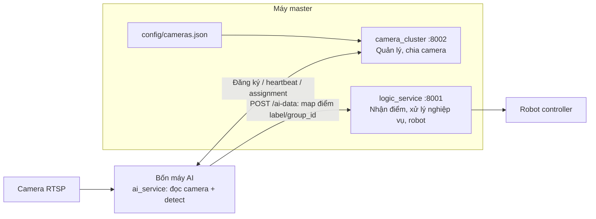

# camera_cluster — Quản lý và phân chia camera

Service độc lập chạy trên máy master, mặc định port 8002. Chỉ quản lý danh sách camera, đăng ký AI, heartbeat, quyền xử lý, thu hồi và cân lại camera. Không nạp model AI, không nhận/chuyển /ai-data, không có POS hoặc lệnh robot. Chưa triển khai HA.

## Kiến trúc đã chốt



camera_cluster và logic_service là hai process, có môi trường/config riêng, có thể đặt trên cùng máy master. Không có luồng dữ liệu detect giữa hai service này. AI kết nối được mọi camera có thể được giao.

## Bốn trường quyền camera

| Trường | Ý nghĩa |
|---|---|
| camera_id | Danh tính camera |
| owner_worker_id | Máy AI giữ quyền; null nếu chưa có chủ |
| assignment_epoch | Lượt cấp quyền, tăng mỗi lần cấp |
| lease_expires_at | Hạn quyền; khi owner=null vẫn giữ hạn cũ để chờ trước khi cấp lại |

Quyền nằm trong RAM. RTSP/ROI/group nằm trong catalog tĩnh; history là ring buffer có giới hạn. File runtime/cluster_boot.json chỉ giữ generation để không tái sử dụng khoảng epoch sau restart, không lưu detect/task. Giữ file này qua nâng cấp.

## Luồng phân chia

1. Nạp JSON khi khởi động; đợi một lease trước khi bắt đầu giao camera.
2. AI register bằng worker_id/token; đăng ký lại thu hồi quyền cũ của worker, giữ hạn lease cũ.
3. AI heartbeat khoảng 3 giây/lần, báo ready và các cặp camera_id/epoch đang giữ quyền. Chỉ gia hạn claim đúng chủ/epoch và còn lease.
4. Sau khi ready ổn định 10 giây, AI đủ điều kiện nhận camera. Tick mỗi giây tính target theo số camera, không theo phần cứng/zone.
5. Khi AI chết, camera hết lease (mặc định 15 giây) được chia cho các máy còn đủ điều kiện.
6. Khi AI trở lại, thu hồi một số camera dư trên các chủ khác, chờ hết hạn quyền cũ rồi cấp epoch mới cho máy còn thiếu. Thu hồi tối đa 10 camera dư mỗi tick.

300 camera: 75/75/75/75 → 100/100/100 → 75/75/75/75. Catalog mẫu hiện có 74 camera/206 ROI: 19/19/18/18 → 25/25/24 → 19/19/18/18. Không bảo đảm camera trở lại đúng máy đã giữ trước khi lỗi.

## API

| API | Vai trò |
|---|---|
| POST /cluster/register | Đăng ký/reset worker |
| POST /cluster/heartbeat | Báo readiness/claim quyền, nhận assignment và gia hạn |
| GET /cluster/state?worker_id=AI-01 | Xem bốn trường quyền và worker; cần token |
| GET /health | Health của controller |

Control API xác thực `Authorization: Bearer <worker-token>`. `/ai-data`, `/task-status`, `/request-ai` không tồn tại trên service này. Mỗi WORKER_ID duy nhất toàn hệ thống, một instance/worker; token không thay thế yêu cầu đó.

## Chạy trên master

```powershell
Set-Location D:/Honda-Camera-AI/camera_cluster
python -m venv .venv
./.venv/Scripts/python.exe -m pip install -r requirements.txt
Copy-Item .env.example .env
Copy-Item config/cameras.example.json config/cameras.json
./.venv/Scripts/python.exe -m uvicorn main:app --host 0.0.0.0 --port 8002 --workers 1
```

Chỉ copy khi các file cấu hình chưa có, không ghi đè bản vận hành. Thay token mẫu và đối chiếu camera/ROI thực. Không --reload hoặc chạy nhiều instance. Service không cần GPU/MongoDB/SQLite.

Trên từng AI, cấu hình hai đường độc lập:

```dotenv
CLUSTER_ENABLED=true
CLUSTER_URL=http://192.168.1.10:8002
AI_DATA_URL=http://192.168.1.10:8001/ai-data
WORKER_ID=AI-01
WORKER_TOKEN=replace-worker-1-token
```

MASTER_URL cũ còn được đọc làm alias nếu chưa có CLUSTER_URL, nhưng khi chuyển phải đặt CLUSTER_URL rõ ràng. AI_DATA_URL là endpoint đầy đủ của logic_service; không đặt về camera_cluster. Để rỗng AI_DATA_URL chỉ khi thử điều phối/capture/detect mà chưa gửi dữ liệu.

## Di chuyển từ phiên bản điều phối trong logic_service

- Dừng các AI và controller cũ, chờ quyền cũ hết trước khi bật bản mới. Không chạy song song hai controller với hai bộ camera/generation khác nhau.
- Chuyển catalog thật từ logic_service/config/cameras.json sang camera_cluster/config/cameras.json. Trong source hiện chỉ có catalog mẫu được di chuyển; không tự tạo/ghi đè config vận hành.
- Giữ nguyên file generation cũ: chuyển logic_service/runtime/cluster_boot.json sang camera_cluster/runtime/cluster_boot.json trước lần chạy mới. Không reset hoặc tạo generation 1 thay cho bản cũ đã hoạt động. Nếu dùng đường dẫn khác thì cấu hình CLUSTER_BOOT_STATE_PATH trỏ đúng file được bảo toàn.
- Đặt cấu hình/token điều phối trong camera_cluster/.env. logic_service không còn giữ token/catalog/lease hoặc tạo runtime điều phối; nó quay về nhận map điểm như luồng có sẵn.
- Không đổi file logic nghiệp vụ, POS, Task Manager hoặc payload lệnh robot. Các cờ CLUSTER_* cũ không còn dùng để điều khiển nghiệp vụ; cấu hình địa chỉ robot và việc vận hành robot vẫn thuộc logic_service hiện có.

## Ranh giới dữ liệu

AI gửi thẳng tới logic_service body chỉ gồm ID điểm → label/group_id, đúng contract cũ; không gửi _cluster/config_version/schema_version/timestamp/point_ids trong body này. Metadata worker/camera/epoch dùng trên heartbeat và kiểm tra quyền cục bộ AI. Hàm tạo payload có _cluster còn dùng để biểu diễn dữ liệu nội bộ, không phải body HTTP tới logic_service.

Do không xử lý detect ở coordinator và không thêm kiểm tra quyền vào nghiệp vụ, logic_service không đối chiếu owner/epoch/lease của từng request; AI phải tự ngừng gửi khi hết quyền. Không bổ sung chống lệnh robot trùng hoặc bảo đảm thứ tự request tới nghiệp vụ trong đợt tách này.

Xem [phân tích từng hàm](docs/code-walkthrough.md), [contract dữ liệu](../docs/contract-ai-to-logic.md) và [nhật ký thay đổi](../docs/logic-service-change-log.md).
