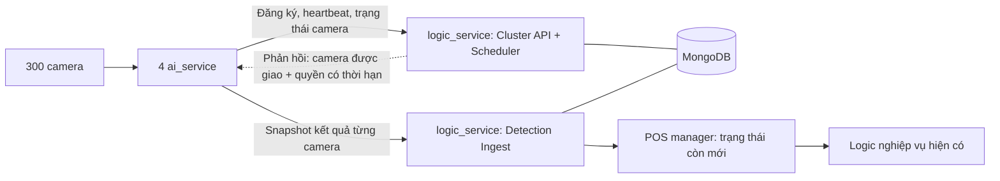

Đề xuất kiến trúc phân công camera và tiếp quản khi máy AI gặp sự cố

> Lịch sử thiết kế trước ngày 11/11/2026. Bản hiện hành đã đơn giản hóa ownership còn camera_id, owner_worker_id, assignment_epoch, lease_expires_at, một control lock và chuyển quyền bằng chờ lease. Những đề xuất session/revision/DRAINING hoặc DB trong tài liệu này không còn là mô tả code đang chạy. Xem [kiến trúc hiện hành](../logic_service/README.md) và [phân tích code](camera-cluster-code-walkthrough.md).

Trạng thái: bản thiết kế đợt đầu được giữ làm lịch sử. Quyết định mới ngày 10/11/2026 đã chuyển catalog sang JSON và trạng thái cluster sang RAM, chỉ giữ boot counter nhỏ để đổi epoch qua restart. MongoDB trong sơ đồ/phân tích bên dưới không còn là backend hiện hành. HA master chưa triển khai. Xem mục 11 của [kế hoạch cập nhật](camera-cluster-implementation-plan.md) và [runbook hiện hành](camera-cluster-operations.md).

Phạm vi đã thống nhất: một máy master chạy logic_service; bốn máy chạy ai_service; 300 camera; chia đều theo số lượng camera, không tính trọng số phần cứng; mục tiêu tiếp quản camera của một máy AI hỏng trong dưới 60 giây. Thiết kế giả định các máy còn lại có thể kết nối các camera được chuyển sang. HA của master không thuộc phạm vi.

Quyết định đề xuất: logic_service là đầu mối duy nhất phân công camera. ai_service nhận phân công qua HTTP, không tự nhận camera từ group_id và không tự tranh quyền trong MongoDB. Master sử dụng MongoDB hiện có để lưu cấu hình, quyền camera và kết quả đã nhận. Không cần thêm scheduler giữa các máy AI, etcd hoặc message broker trong phiên bản này.



1. Các nguyên tắc mà triển khai phải giữ

- Mỗi camera chỉ có một bản ghi quyền hiện hành, dùng camera_id làm khóa duy nhất.
- Mỗi bản ghi chỉ có một owner_worker_id và owner_session_id. Chỉ master được thay đổi chúng.
- assignment_epoch tăng sau mỗi lần cấp quyền mới; không reset khi đổi máy hoặc khởi động lại tiến trình.
- session_id thay đổi sau mỗi lần khởi động ai_service; worker_id là định danh ổn định của máy.
- AI khởi động với danh sách camera rỗng. Cache và cấu hình nhóm cũ không cấp quyền mở camera.
- Master chỉ nhận snapshot đúng owner, session, epoch, cấu hình, thời hạn và số frame mới hơn.
- Một snapshot được chấp nhận cập nhật toàn bộ ROI của frame đó cùng nhau.
- Khi đổi quyền, các quan sát của phiên trước không còn được dùng để quyết định nghiệp vụ mới.
- Khi mất nguồn dữ liệu, trạng thái cảm nhận là UNKNOWN; khóa của task đang chạy được giữ riêng.
- Có thể còn request cũ trên đường truyền hoặc luồng RTSP cũ chưa đóng ngay. Bảo đảm chính là không cho dữ liệu của quyền đã thu hồi cập nhật trạng thái master. Không tuyên bố tuyệt đối không thể tồn tại hai kết nối RTSP trong mọi dạng lỗi.

2. Những phần hiện tại cần thay đổi

| File | Hiện trạng liên quan | Hướng thay đổi |
|---|---|---|
| ai_service/services/camera_orchestrator_service.py | start() đọc camera theo group_id một lần; chia danh sách cố định cho các process; reporter gửi lại toàn bộ target_dict | Lấy phân công từ master, đối chiếu danh sách liên tục, thêm/dừng từng camera, tách reporter |
| ai_service/services/camera_process_worker.py | Tạo thread lúc khởi động rồi chỉ giữ process sống | Nhận lệnh START/STOP qua multiprocessing.Queue; quản lý thread theo camera_id |
| ai_service/services/camera_thread_worker.py | Khóa shared_dict là camera_name; chưa có phiên quyền hoặc số frame | Khóa theo camera_id; gắn session/epoch/seq/thời gian quan sát; dừng có timeout |
| ai_service/services/yolo_detector.py | Metadata quyền không đi cùng frame; target_dict phẳng theo ROI; cùng frame có thể được suy luận lại | Giữ nguyên metadata từ capture qua inference; không xử lý lại cùng frame; xuất snapshot theo camera |
| ai_service/main.py | Startup mở camera ngay; /health luôn healthy | Đăng ký phiên, kiểm tra model và worker, sẵn sàng mới nhận camera |
| logic_service/api/receive_data.py | /ai-data gọi thẳng pos_manager.update_state | Validate schema và quyền qua DetectionIngest trước khi cập nhật trạng thái |
| logic_service/services/POS_manager.py | Dùng thời gian nhận; trộn nhãn quan sát với block; hàm update có thể gọi HTTP robot | Theo dõi tuổi quan sát, khoảng gián đoạn, phiên quyền; tách trạng thái/khóa và tách cập nhật khỏi gọi mạng |

group_id tiếp tục biểu diễn nhóm nghiệp vụ hoặc nhóm hiển thị. Nó không còn quyết định camera phải chạy trên máy nào. camera_name chỉ là tên hiển thị. camera_id dùng ID ổn định của camera trong MongoDB.

3. Thành phần đề xuất trong logic_service

| Thành phần | Trách nhiệm |
|---|---|
| api/cluster.py | API đăng ký, heartbeat, trạng thái camera và quan sát cụm |
| schemas/cluster.py và schemas/detection.py | Hợp đồng dữ liệu có phiên bản, kiểm tra kiểu và trường bắt buộc |
| services/worker_registry.py | Quản lý worker/session, readiness, heartbeat, tiến độ inference |
| services/camera_scheduler.py | Tính phân công đều, chuyển camera khi lỗi, cân lại khi máy trở về |
| services/assignment_manager.py | Cấp/gia hạn/thu hồi quyền, epoch, handover và khóa điều phối theo camera |
| services/detection_ingest.py | Kiểm tra quyền, thứ tự, tuổi frame; cập nhật snapshot nguyên tử; phản hồi từng camera |
| repositories/cluster_repository.py và core/database.py | Truy cập MongoDB, conditional update, đọc cấu hình |
| POS_manager.py | Áp dụng quan sát hợp lệ, quản lý UNKNOWN và xác nhận trạng thái |

Phiên bản đầu chạy đúng một process ứng dụng master, một scheduler, không bật auto-reload trong vận hành. Các request vẫn xử lý bất đồng bộ. Khóa asyncio chỉ có hiệu lực trong process đó. Nếu sau này chạy nhiều Uvicorn worker, phải thiết kế lại việc phối hợp scheduler và state projection; thêm --workers không tự làm chúng dùng chung RAM.

Không chờ HTTP gọi RCS trong đoạn khóa camera. Cập nhật trạng thái quan sát là thao tác ngắn; logic nghiệp vụ chạy sau đó và phải kiểm tra dữ liệu còn hợp lệ trước khi tạo công việc. Chống trùng một task robot là lớp nghiệp vụ riêng, không suy ra từ chống trùng frame.

4. Thành phần đề xuất trong ai_service

| Thành phần | Trách nhiệm |
|---|---|
| services/cluster_client.py | Đăng ký, heartbeat, lấy phân công, gửi báo cáo STARTED/STOPPED/FAILED |
| services/assignment_reconciler.py | So sánh phân công master với camera thực chạy; xử lý start/stop idempotent |
| camera_orchestrator_service.py | Quản lý các process, model và vòng đời các thành phần |
| camera_process_worker.py | Quản lý thread động bằng hàng đợi lệnh và phản hồi |
| camera_thread_worker.py | Đọc frame; gắn định danh và số thứ tự trước inference |
| yolo_detector.py | Batch inference, giữ nguyên định danh frame, loại kết quả của quyền đã mất |
| services/result_reporter.py | Gửi snapshot mới nhất; retry giữ nguyên định danh; dừng gửi khi mất quyền |
| services/health_monitor.py | Theo dõi tiến trình capture/inference và tiến độ thực, không chỉ API còn sống |

Trạng thái desired (được master giao) và observed (đã thực sự mở camera, đã có inference) phải tách nhau. Camera chỉ được báo RUNNING sau khi có kết quả mới đầu tiên, không phải khi vừa tạo thread.

Không giữ hàng đợi frame vô hạn. Duy trì snapshot mới nhất cho mỗi camera; frame mới thay frame chưa gửi cũ. Đây là kênh trạng thái hiện tại, không phải nhật ký bảo đảm lưu mọi sự kiện.

Khi STOP: chặn reporter cho quyền đó trước; dừng capture; loại frame và kết quả cũ; chờ worker dừng; mới báo STOPPED. Kết quả inference đang tính dở có thể hoàn thành sau lúc xóa dictionary, vì vậy phải kiểm tra lại epoch trước khi ghi target_dict và trước khi gửi. Nếu thread đọc video kẹt, không báo đã dừng thành công; cần timeout đọc thực của backend và cơ chế khôi phục process bị kẹt. Nếu process chứa nhiều camera, phải phục hồi cả các camera bị ảnh hưởng theo phân công còn hiệu lực.

5. Dữ liệu lưu trong MongoDB

Giữ collection cameras hiện có, bổ sung config_version. Master trả cấu hình cần thiết cho AI qua API. AI không ghi bảng phân công và không tự đọc group_id để khởi chạy camera.

| Collection | Dữ liệu chính |
|---|---|
| cameras | camera_id, đường dẫn video, ROI, group_id, enabled, config_version |
| ai_workers | worker_id, session_id hiện hành, trạng thái, last_heartbeat_at, readiness, assignment_revision |
| camera_runtime | Một document/camera: owner, epoch, thời hạn quyền, trạng thái chuyển giao, frame cuối và snapshot |
| assignment_events | Lịch sử cấp/thu hồi/chuyển camera phục vụ điều tra; không dùng làm nguồn cấp quyền |

Ví dụ camera_runtime (các chuỗi thời gian dưới đây chỉ diễn tả tên trường, khi lưu dùng kiểu Date):

```json
{
  "_id": "CAM-001",
  "owner_worker_id": "AI-02",
  "owner_session_id": "boot-b72",
  "assignment_epoch": 18,
  "assignment_state": "ASSIGNED",
  "lease_expires_at": "<master-issued deadline>",
  "config_version": 4,
  "last_frame_seq": 851,
  "latest_sample": {
    "frame_observed_at": "<UTC timestamp>",
    "received_at": "<master UTC timestamp>",
    "rois": [{"roi_id": "ROI-1", "label": "hang"}]
  }
}
```

Đổi owner, tăng epoch, reset last_frame_seq và vô hiệu latest_sample phải cùng một conditional update trên document camera. Khi nhận kết quả, so khớp owner/session/epoch/state/deadline/config và frame_seq > last_frame_seq, rồi ghi cả last_frame_seq lẫn latest_sample trong một update. Không lưu dấu đã nhận trước rồi mới lưu payload ở bước rời rạc.

MongoDB bảo đảm cập nhật nguyên tử trên một document và đánh giá điều kiện khi có cập nhật đồng thời: https://www.mongodb.com/docs/manual/core/write-operations-atomicity/

Không dùng TTL index để quyết định lúc chuyển camera. Scheduler kiểm tra deadline trực tiếp mỗi giây; TTL index chỉ thích hợp cho dọn lịch sử. Xóa bằng TTL có thể trễ và không bảo đảm xảy ra ngay tại thời điểm hết hạn: https://www.mongodb.com/docs/manual/core/index-ttl/

Không xóa document camera_runtime rồi tạo lại epoch từ đầu. Các cập nhật quyền phải được xác nhận lưu thành công trước khi master trả quyền mới. Khi MongoDB không truy cập được, không cấp/gia hạn quyền hoặc trả accepted cho snapshot chưa lưu được. AI dừng theo deadline đã có; master không dùng dữ liệu hết hạn.

6. API giữa hai service

| API trên logic_service | Nội dung |
|---|---|
| POST /cluster/register | worker_id, session_id, trạng thái model; đăng ký idempotent cho cùng phiên |
| POST /cluster/heartbeat | Danh tính phiên, heartbeat_seq, revision đã áp dụng, tiến độ inference, trạng thái camera; trả quyền được gia hạn và phân công hiện hành khi có thay đổi |
| POST /cluster/camera-status | camera_id, epoch, STARTED/STOPPED/FAILED và lý do; báo cáo cũ không được tác động phiên mới |
| POST /ai-data | Batch snapshot theo camera với schema_version=2; kiểm tra và trả kết quả từng phần tử |
| GET /cluster/state | Máy nào phụ trách camera nào, trạng thái thực, frame cuối, nguyên nhân bị loại |

Tất cả kết nối do AI chủ động mở tới master. Không cần master mở HTTP tới từng AI. Heartbeat mỗi 3 giây cũng là kênh lấy phân công. Phản hồi có assignment_revision tăng dần; AI không áp dụng phản hồi cũ đến muộn. START và STOP lặp lại cùng camera/epoch phải không tạo thêm thread hoặc tác động nhầm phiên.

worker_id gắn với danh tính đã cấu hình của máy; master xác thực worker bằng thông tin kết nối được cấp, không chỉ tin một worker_id tùy ý trong JSON. session_id là mã phiên, không phải mật khẩu. Nếu hai tiến trình đăng ký cùng worker_id khi phiên cũ còn hiệu lực, trả xung đột cho phiên mới và chờ phiên cũ kết thúc hoặc bị thu hồi; không cho chúng thay nhau giành tên máy.

Một kết quả minh họa:

```json
{
  "schema_version": 2,
  "worker_id": "AI-02",
  "session_id": "boot-b72",
  "items": [
    {
      "camera_id": "CAM-001",
      "assignment_epoch": 18,
      "config_version": 4,
      "frame_seq": 852,
      "frame_observed_at": "2026-11-10T08:00:00.000Z",
      "inferred_at": "2026-11-10T08:00:00.120Z",
      "rois": [{"roi_id": "ROI-1", "label": "hang"}]
    }
  ]
}
```

frame_seq tăng khi lấy một frame mới đưa vào xử lý, không tăng khi gửi HTTP hoặc suy luận lại. ROI phải thuộc cấu hình camera trên master; ánh xạ ROI sang vị trí nghiệp vụ cũng lấy từ cấu hình tin cậy. group_id không dùng làm khóa chống trùng.

Nếu bộ đếm bị reset do process camera khởi động lại, xin cấp epoch mới trước khi gửi tiếp. Reconnect camera mà bộ đếm và phiên vẫn còn nguyên thì có thể tiếp tục tăng seq.

Phản hồi từng item gồm accepted, duplicate, out_of_order, stale, wrong_assignment, expired hoặc invalid_config. Bản duplicate không retry vô hạn và không làm mới thời gian quan sát. wrong_assignment khiến AI dừng quyền tương ứng và đồng bộ phân công. Timeout/5xx có thể retry snapshot còn mới, giữ nguyên session/epoch/frame_seq; snapshot đã bị kết quả mới thay thế có thể bỏ.

Khi chuyển sang giao thức mới, không giữ đường vào cũ cho phép camera đã quản lý bỏ qua kiểm tra quyền. Nếu triển khai từng nhóm, phải có danh sách camera thuộc v1/v2 rõ ràng và chỉ một đường ghi trạng thái cho mỗi camera.

7. Chia đều và chuyển giao

Với N camera enabled và K worker READY, mỗi worker nhận floor(N/K) hoặc ceil(N/K) camera. Khi hệ ổn định, chênh lệch tối đa một camera. Trong giai đoạn đang chuyển giao có thể tạm lệch.

Scheduler giữ tối đa phân công đang hợp lệ, chỉ chuyển phần cần thiết. Sắp xếp worker/camera theo ID để kết quả tính toán ổn định. Camera đang STARTING vẫn được tính vào số đã giao; một camera đang chuyển chỉ có một thao tác handover hiện hành. Camera mất tín hiệu vẫn được tính vào phân công, không chuyển qua lại vô hạn chỉ vì camera nguồn hỏng.

Ví dụ 300 camera: 75/75/75/75; khi AI-01 chết: 0/100/100/100; khi AI-01 READY trở lại và cân xong: 75/75/75/75. Không bắt buộc trả đúng các camera cũ về AI-01; chuyển tối thiểu 25 camera từ mỗi máy còn lại là đủ.

Máy chết: heartbeat ngừng, quyền hết hạn; master vô hiệu quan sát cũ, cấp epoch mới cho máy khác; máy nhận bắt đầu đọc. Máy cũ trở lại phải đăng ký phiên mới và chờ phân công. Không dùng lại danh sách cũ.

Chuyển có kế hoạch: master đặt camera DRAINING, ngừng nhận snapshot của quyền đó và không gia hạn tiếp; AI nhận yêu cầu dừng, dọn pipeline và xác nhận STOPPED; master cấp epoch mới cho máy nhận. Nếu không nhận xác nhận, chờ deadline quyền cũ trước khi cấp. Trong lúc chuyển, trạng thái quan sát là UNKNOWN. Phản hồi STOPPED của epoch cũ không được giải phóng quyền mới.

Khi máy trở về, chờ readiness ổn định khoảng 10 giây, sau đó cân lại theo đợt nhỏ. Đây là cơ chế tự động, phù hợp yêu cầu luôn chia đều sau khi hệ ổn định.

8. Điểm chặn dữ liệu trùng và cuộc đua với scheduler

Thứ tự kiểm tra: xác thực worker/session; camera tồn tại; đúng owner/epoch/config; assignment còn nhận dữ liệu và lease chưa hết; frame chưa quá cũ; frame_seq lớn hơn lần đã nhận.

Database conditional update giải quyết cuộc đua lưu dữ liệu với thay quyền. Tuy nhiên, dữ liệu đã được chấp nhận trước chuyển quyền có thể vẫn chờ cập nhật POS. Vì vậy assignment_manager và detection_ingest còn phải dùng cùng khóa ngắn theo camera trong process master: cập nhật quyền, vô hiệu POS cũ và áp dụng quan sát không được chạy xen kẽ sai thứ tự.

Mọi công việc xử lý chậm giữ camera_id/epoch/seq và kiểm tra lại trước khi tác động trạng thái. Không xếp một dictionary ROI đã bỏ metadata vào hàng đợi để sau này gọi update_state tùy ý. Nếu lỗi sau khi lưu latest_sample nhưng trước khi áp dụng POS, reconciler áp dụng lại snapshot còn mới, đúng quyền; POS theo dõi applied_epoch/seq để áp dụng idempotent. Khi snapshot cũ bị thay thế, dùng snapshot mới nhất; không yêu cầu phát lại mọi frame đã bỏ.

Ví dụ CAM-001 đổi từ AI-01/session-A/epoch-17 sang AI-02/session-B/epoch-18. Gói của epoch-17 đến sau đổi quyền luôn bị loại. Hai request epoch-18/seq-852 đồng thời chỉ một request được cập nhật. Frame 851 đến sau 852 bị loại. Frame 853 đúng phiên được áp dụng.

9. Tuổi dữ liệu và POS manager

frame_observed_at phải theo frame đọc được, không thay bằng thời gian inference lại hoặc gửi lại. Đây là thời điểm ứng dụng quan sát frame, chưa chắc là timestamp vật lý của camera nếu bộ giải mã bị đệm; capture pipeline phải kiểm soát độ trễ bộ đệm. Đồng bộ đồng hồ các máy và kiểm tra timestamp bất thường.

Ngưỡng đề xuất để thử: frame quá 3 giây không được dùng; không có frame hợp lệ mới quá 3 giây thì UNKNOWN. Khoảng xác nhận 5 giây phải dựa trên các frame mới và không có khoảng mất quan sát vượt ngưỡng. Khi đổi epoch, có khoảng trống hoặc đổi cấu hình ROI, reset trạng thái đang chờ xác nhận. Không dùng duplicate để hoàn thành khoảng xác nhận.

Tách observation_label/quality/last_observed_at khỏi reservation_task_id hoặc trạng thái block. Giữ được khóa task khi camera chuyển máy; vẫn cập nhật sức khỏe quan sát ngay cả khi vị trí đang bị khóa. get_state() và các logic PA/KD/DCC phải xử lý UNKNOWN rõ ràng, không xem UNKNOWN là trong.

10. Thời gian và các loại lỗi

| Tham số đề xuất | Giá trị ban đầu |
|---|---:|
| Heartbeat | 3 giây |
| Lease được gia hạn | 15 giây |
| Scheduler kiểm tra | 1 giây |
| Nhận phân công qua heartbeat | Tối đa khoảng 3 giây khi mạng bình thường |
| Ngân sách mở camera tới kết quả mới | 25 giây cho toàn bộ tập camera cần phục hồi |
| Xác nhận trạng thái sau gián đoạn | 5 giây |
| Readiness ổn định trước cân tải khi máy trở lại | 10 giây |

Ngân sách từ sự cố tới trạng thái dùng được: khoảng 15 + 1 + 3 + 25 + 5 = 49 giây. Mốc 25 giây phải đo cho toàn bộ camera được chuyển, không chỉ một camera. Đây là mục tiêu nghiệm thu dưới một phút khi các camera và mạng còn hoạt động, chưa phải kết quả benchmark.

AI dùng monotonic clock để tự hết quyền, với khoảng an toàn trước deadline; tính cả thời gian request/response, không bắt đầu lại đủ 15 giây khi một phản hồi gia hạn cũ đến muộn. Master cấp deadline và kiểm tra hạn của quyền. Không phụ thuộc vào việc hai máy tự so đồng hồ với nhau để quyết định quyền sở hữu.

| Lỗi | Hành vi cần có |
|---|---|
| Tắt hẳn một máy AI | Hết quyền, phân lại camera, kết quả epoch cũ bị loại |
| API AI còn sống nhưng YOLO treo | Heartbeat báo không có tiến độ; thử phục hồi cục bộ có thời hạn; nếu thất bại thu hồi các camera bị ảnh hưởng |
| Một camera mất video | UNKNOWN cho camera đó, reconnect có backoff; tránh chuyển cả máy hoặc đổi owner liên tục |
| AI không tới được master nhưng vẫn tới camera | AI hết quyền thì dừng đọc/gửi; master chỉ nhận owner mới |
| Phản hồi heartbeat/HTTP bị trễ | Revision/heartbeat_seq và deadline ngăn phục hồi quyền cũ |
| MongoDB mất kết nối | Không cấp hoặc gia hạn quyền không xác nhận được; không chấp nhận snapshot chưa lưu được |
| Master khởi động lại | Trước readiness, vô hiệu các quyền cũ bằng tăng epoch, xóa quan sát cũ; tái đăng ký và cấp quyền lại. Nếu cần tránh mở RTSP chồng nhau, đợi quyền cũ hết hoặc nhận STOPPED trước mở mới |

Hành vi restart master ở đây chỉ xử lý quyền camera và dữ liệu cảm nhận. Khôi phục task robot đang chạy là vấn đề riêng; không suy luận rằng giao thức camera đã giải quyết nó.

11. Trình tự triển khai và nghiệm thu

1. Xây schema v2, camera_runtime, registry và assignment_manager; dùng AI giả lập để chứng minh mỗi camera chỉ có một quyền được chấp nhận.
2. Xây worker động, start/stop theo camera_id và epoch; kiểm tra không còn frame/kết quả của quyền cũ sau khi nhả.
3. Xây scheduler chia đều, heartbeat, timeout, tiếp quản và cân lại khi worker trở về.
4. Đặt DetectionIngest trước POS; sửa tuổi dữ liệu, UNKNOWN, reset xác nhận và tách khóa task khỏi nhãn quan sát.
5. Thử nghiệm trên nhóm camera nhỏ; sau đó đo toàn bộ tình huống chuyển camera ở quy mô 300.

| Ca nghiệm thu | Điều phải chứng minh |
|---|---|
| Tắt AI-01 | Các máy còn lại tiếp quản; không camera bị bỏ sót; cân đều sau ổn định |
| AI-01 khởi động lại với cấu hình cũ | Không tự mở camera cũ; nhận phiên mới; cân lại đúng số lượng |
| Cố gửi kết quả epoch cũ sau khi chuyển | Không thay đổi POS, không làm mới tuổi dữ liệu |
| Hai request giống nhau đồng thời | Snapshot chỉ được áp dụng một lần |
| Frame đến sai thứ tự | Frame cũ không ghi đè frame mới |
| STOP trong lúc inference đang tính | Kết quả cũ hoàn thành muộn không quay lại reporter hoặc POS |
| Mất mạng một chiều và phản hồi đến trễ | Không gia hạn nhầm phiên cũ, không nhận dữ liệu ngoài quyền |
| YOLO treo nhưng heartbeat API còn sống | Hệ thống phát hiện mất tiến độ và phục hồi/thu hồi |
| Camera mất tín hiệu | UNKNOWN; không biến thành trong và không tự xóa khóa task |
| Đồng thời chuyển quyền và nhận kết quả | Không có trạng thái epoch cũ được áp dụng sau bước vô hiệu |
| Mất MongoDB | Không có quyền mới được cấp dựa trên trạng thái không xác nhận |
| Chuyển camera quy mô đầy đủ | Camera cuối cùng phục hồi trong mục tiêu 60 giây; số liệu tách thời gian detect lại và xác nhận nghiệp vụ |

Các quyết định đề xuất để thảo luận: đặt scheduler trên master; dùng HTTP heartbeat kiêm lấy phân công; dùng MongoDB hiện có; tự động cân lại khi máy phục hồi; chấp nhận khoảng UNKNOWN khi chuyển; ưu tiên snapshot mới nhất; phân biệt chống trùng dữ liệu camera với chống trùng task robot. Các con số 3/15/25/5 giây là cấu hình ban đầu để đo và điều chỉnh.
