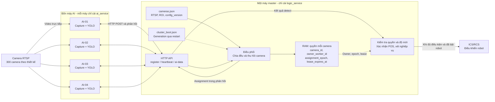
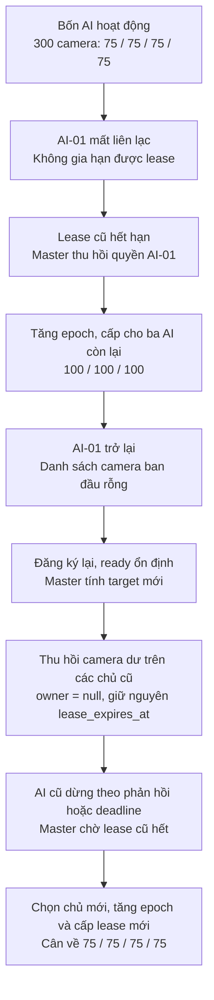

# Phân tích code hiện hành: bốn trường quyền camera

Cập nhật 11/11/2026. Thay bản phân tích session/revision/DRAINING trước đây. Mỗi bản ghi ownership chỉ gồm camera_id, owner_worker_id, assignment_epoch, lease_expires_at. Cấu hình ảnh và dữ liệu POS nằm riêng.

> Phạm vi thay đổi format mới: chỉ làm phía AI gửi map điểm + _cluster rút gọn theo contract. Metadata chỉ có worker_id và cặp camera_id/assignment_epoch; không có config_version, schema_version, frame_observed_at, inferred_at, point_ids. Bộ nhận master bên dưới vẫn là v3; không sửa POS/robot. Sơ đồ luồng mới cần phần nhận tích hợp riêng mới chạy xuyên suốt; hiện payload mới bị master cluster trả 422.

## Sơ đồ tổng quan kiến trúc

Hệ thống hiện có một máy master cài `logic_service` và bốn máy AI chỉ cần cài `ai_service`. Danh sách camera được cấu hình tập trung trên master; mọi máy AI phải truy cập được các camera có thể được giao. Chưa triển khai master standby/HA.



Mũi tên video tới bốn AI thể hiện khả năng kết nối, không có nghĩa mỗi AI đọc toàn bộ camera. Ở thời điểm hoạt động bình thường, mỗi camera chỉ được chủ đang có quyền đọc và gửi kết quả.

Ba luồng chính:

| Luồng | Đường đi | Nội dung |
|---|---|---|
| Video | Camera → AI được giao | RTSP, giải mã ảnh và detect tại AI; không chuyển video qua master |
| Điều phối | AI → master → phản hồi cho AI | Register, heartbeat và danh sách assignment/cấu hình camera |
| Nghiệp vụ | AI → master → robot | Map điểm label/group_id và _cluster rút gọn; phần nhận mới cần làm riêng trước khi chạy xuyên suốt |

AI chủ động gửi request. Các chiều master → AI trong sơ đồ là phản hồi HTTP, không phải master mở kết nối để đẩy lệnh sang AI. AI không cài `logic_service`, không giữ file camera làm nguồn phân công riêng và không tự quyết định camera nào thuộc máy mình.

File mặc định master đọc là `config/cameras.json`, theo `CLUSTER_CAMERA_CONFIG_PATH`; `cameras.example.json` là file nguồn mẫu để chuẩn bị cấu hình. Chỉ sửa file được master sử dụng, tăng config_version nếu đổi RTSP/ROI và restart logic_service để nạp lại. Không cần sửa file trên bốn AI. Restart master làm mất task trong RAM nên cần đối soát nhiệm vụ đang chạy.

## Sơ đồ luồng chạy bình thường

```mermaid
sequenceDiagram
    participant C as Camera
    participant A as Một máy AI
    participant M as Master
    participant R as ICS/RCS

    Note over A,M: Sender mới rút gọn metadata; cần tích hợp bộ nhận riêng để chạy luồng dưới đây
    Note over M: Nạp JSON và generation, chờ lease cũ sau startup
    A->>M: POST /cluster/register: worker_id + Bearer token
    M-->>A: Phản hồi đăng ký, chưa có camera
    A->>M: POST /cluster/heartbeat: ready, camera claims
    Note over M: AI ready ổn định; tick chia đều và cấp epoch/lease
    A->>M: Heartbeat tiếp theo
    M-->>A: Assignment + RTSP/ROI + epoch/lease
    A->>C: Mở RTSP của camera được giao
    C-->>A: Video
    Note over A: Resize, YOLO và tạo hang/trong cho điểm xác định được
    A->>M: POST /ai-data: map điểm, worker_id và camera_id/epoch
    Note over M: Kiểm tra chủ, epoch, lease, config và độ mới; xác nhận POS
    opt Robot đã bật và nghiệp vụ đủ điều kiện
        M->>R: Gửi nhiệm vụ robot
    end
    M-->>A: Trạng thái xử lý snapshot
    loop Heartbeat định kỳ, khoảng nghỉ mặc định 3 giây
        A->>M: Ready + các camera/epoch còn giữ quyền
        M-->>A: Gia hạn lease hợp lệ và trả assignment hiện tại
    end
```

Một AI có nhiều capture process; mỗi camera là một thread đọc RTSP và một detector process chạy YOLO theo batch. Master chia camera giữa các máy; AI chỉ phân các camera mình được giao vào các process nội bộ.

Các tham số mẫu: lease 15 giây, heartbeat nghỉ 3 giây giữa các vòng, tick master 1 giây và ready ổn định 10 giây trước khi đủ điều kiện nhận camera. Thời gian thực tế giữa hai heartbeat còn gồm thời gian request và chờ khóa HTTP. Detect gửi bằng vòng riêng với khoảng nghỉ 1 giây, timeout HTTP mẫu 2 giây; không phải chờ heartbeat kế tiếp. Body chi tiết theo [contract AI → logic](contract-ai-to-logic.md).

## Sơ đồ chuyển camera khi một AI chết và quay lại



Với 74 camera hiện có trong catalog mẫu, số tương ứng là 19/19/18/18 → 25/25/24 → 19/19/18/18. Camera được giao lại không nhất thiết quay về máy từng giữ nó trước khi lỗi. Cân theo số lượng camera, không theo GPU/CPU/zone.

Cơ chế chống trùng có hai lớp: master không cấp lease mới trước hạn quyền cũ; kết quả gửi về chỉ hợp lệ khi đúng owner, đúng epoch và còn lease. Ví dụ CAM-01 đã chuyển từ AI-01 epoch 7 sang AI-02 epoch 8 thì kết quả epoch 7 bị loại. Camera chuyển về cùng AI-01 ở lượt sau cũng phải có epoch mới.

Chỉ bốn trường quyền là đủ để phân biệt trạng thái chờ và đang chạy: owner khác null và lease còn hạn là đã giao; owner=null nhưng lease còn ở tương lai là đang chờ quyền cũ hết; owner=null và lease đã qua là có thể cấp lại. Không dùng DRAINING, blocked_until hoặc API STOPPED trên master.

Giới hạn hiện tại: một RTSP lỗi riêng vẫn được retry tại AI, chưa tự chuyển máy chỉ vì thiếu frame; kết nối RTSP treo có thể chưa biến mất ngay dù quyền đã bị chặn. Mục tiêu phục hồi dưới một phút phụ thuộc RTSP/model và năng lực các máy còn lại, chưa phải cam kết đã nghiệm thu trên camera thật.

## Quy trình và các bất biến

- Master duy nhất quyết định phân công; một control lock tuần tự hóa mọi thay đổi và ingest.
- Cấp quyền mới luôn tăng epoch; dữ liệu chủ cũ hoặc lượt cũ không được áp dụng.
- Thu hồi: đặt owner=null nhưng giữ lease_expires_at. Chỉ cấp lại khi thời điểm đó đã qua.
- AI điều khiển HTTP tuần tự, không có revision/session trong giao thức. Mỗi worker phải là một instance duy nhất; khóa file cục bộ không bảo vệ trùng ID trên hai máy.
- Register luôn thu hồi quyền cũ của worker, dù là restart hay retry vì mất phản hồi.
- Heartbeat chỉ gia hạn những camera còn lease, đúng owner/epoch và được AI claim khi ready. Không kéo dài lease một camera chỉ dựa trên worker ID.

## 1. logic_service/services/cluster_runtime.py

[Mở code](../logic_service/services/cluster_runtime.py).

| Hàm | Hoạt động và tác động |
|---|---|
| ClusterError.__init__() | Lưu status/message để API chuyển thành HTTP error. |
| ClusterRuntime.__init__() | Nhận repository/settings/POS/clock; tạo catalog, workers, control lock, counters và trạng thái vòng nền. Không cấp camera. |
| authenticate() | Tra token worker, so sánh constant-time; sai thì 401. |
| require_ready() | Yêu cầu healthy và watchdog deadline master chưa hết; lỗi 503 nếu controller không chạy đúng. Không phải lease HA. |
| _save_camera() | Ghi bốn trường qua repo.save_camera; nếu có reason thì thêm event vào ring buffer giới hạn. Không cần CAS/revision vì cùng control lock. |
| _revoke() | Xóa owner, giữ nguyên epoch/lease; ghi trạng thái và vô hiệu hóa quan sát POS. Lease cũ trở thành hàng rào chờ cấp lại. |
| start() | Đọc catalog đã validate, tạo row owner=null/epoch_base/lease bằng recovery_until; invalidate POS rồi bật vòng nền. Không có snapshot cũ trong repo. |
| stop() | Healthy=false, hủy loop, đóng repo và khóa OS của master. Không xóa boot counter. |
| _loop() | Gọi tick theo interval; lỗi thì unhealthy và dừng, cần restart. |
| _worker() | Tìm worker đã register; không có thì 409. Không kiểm tra session. |
| register() | Giữ control, thu hồi toàn bộ camera còn thuộc worker, reset ready/ready_since và ghi last_seen. Trả danh sách hiện tại, thường rỗng. Retry cũng an toàn vì không bỏ hạn lease cũ. |
| heartbeat() | Cập nhật last_seen/ready/ready_since; giữ mốc ổn định nếu chưa gián đoạn heartbeat quá lease. Gia hạn chỉ những claim đúng camera/epoch/chủ, lease chưa hết và máy ready. Trả assignments hiện tại. |
| _response() | Ghép catalog tĩnh với ownership bốn trường, chỉ lấy camera đúng chủ và còn lease. Kèm worker_id, server_time và heartbeat_interval; không có state/revision/session. |
| tick() | Chọn worker đủ điều kiện, thu hồi quyền hết hạn, tính targets, cấp camera trống đã qua hạn chờ và thu hồi số camera dư để cân lại. Chi tiết bên dưới. |
| ingest() | Bộ nhận hiện tại vẫn là v3: giữ control, kiểm tra worker đã đăng ký, đúng owner/epoch, còn lease, config/ROI/timestamp đúng. Gọi POS trực tiếp rồi trả status theo item; chưa đọc map điểm/_cluster rút gọn. |
| state() | Giữ control, trả đúng bốn trường mỗi camera, trạng thái worker/counters/history. Không có frame_seq/frame_age/observation_fresh hoặc URL camera. |
| get_runtime() | Trả singleton đang chạy; chưa có thì lỗi 503. |
| start_runtime() | Validate hai đường dẫn khác nhau, load JSON trong thread, mở boot counter/OS lock, tạo RAM repo với epoch base mới, start runtime. Lỗi thì đóng khóa. |

### Bên trong tick()

1. Kiểm tra ready; cập nhật watchdog deadline controller thêm 30 giây.
2. Chọn eligible: ready, last_seen còn hạn và ready liên tục đủ recovery delay; sắp xếp theo worker ID.
3. Với row còn owner nhưng lease hết: _revoke(). Row trong danh sách đang xét cũng thành owner=null.
4. Nếu không có máy eligible thì kết thúc; không cấp camera dù còn camera trống.
5. Tính counts từ owner hiện tại; targets bằng N//M, phần dư thêm một camera cho các worker đầu theo ID.
6. Duyệt camera ID tăng dần; camera chỉ được chọn nếu owner=null và lease_expires_at<=now. Giao cho worker chưa đủ target đang ít camera nhất; tăng epoch và đặt lease=now+lease_seconds, reset quan sát POS.
7. Duyệt camera ID giảm dần; chủ nào giữ quá target thì thu hồi camera bằng _revoke(), giảm count ngay. Tối đa rebalance_batch camera/tick.

Khi thu hồi để cân lại, counts giảm ngay nhưng lease cũ vẫn còn. Chưa giao camera sang máy mới trong khoảng chờ này. Không cần trạng thái DRAINING, blocked_until hoặc xác nhận STOPPED.

### Kết quả ingest()

| Status | Nguyên nhân |
|---|---|
| wrong_assignment | Không có camera, owner đã null/khác worker hoặc epoch sai |
| expired | Đúng chủ/epoch nhưng lease hết |
| invalid_config | Config version hoặc tập ROI khác catalog ở bộ nhận v3 hiện tại |
| stale | Frame quá cũ, quá xa tương lai hoặc thời gian inference không hợp lệ |
| accepted | Qua các kiểm tra và đã gọi POS; chưa đồng nghĩa đã gọi robot |

POS hiện tại dùng cặp epoch/timestamp đã áp dụng để bỏ dữ liệu trùng hoặc cũ. Batch v3 gửi lại có thể vẫn trả accepted nhưng không áp dụng hai lần vào POS. Việc đọc map điểm và các quy tắc nghiệp vụ trong contract mới chưa được sửa theo phạm vi phía gửi. Payload rút gọn không có timestamp hoặc point_ids; bộ nhận tương lai phải tra catalog để biết camera của từng điểm, không thể dùng dữ liệu trên wire để xác định tuổi frame.

## 2. ai_service/services/cluster_runtime.py

[Mở code](../ai_service/services/cluster_runtime.py).

| Hàm | Hoạt động và tác động |
|---|---|
| lease_deadline() | Tính deadline monotonic từ thời điểm bắt đầu request + khoảng lease còn lại do master trả - margin. Response chậm không kéo dài quyền. |
| ClusterAIService.__init__() | Lưu worker/settings; dựng WorkerLock, HTTP lock, spawn context và dict assignments/stopping/rejected/sent. Không session/sequence/revision. |
| start() | Giữ khóa worker rồi gọi _start(); startup lỗi thì stop dọn tài nguyên. |
| _start() | Tạo Manager/shared dict/queues/event, HTTP client, capture processes, detector và ba task điều khiển/report/watchdog. |
| _spawn_capture() | Tạo capture process và queue lệnh; nếu có index thì thay slot process lỗi, đóng queue cũ. |
| _spawn_detector() | Reset health, ghi model_started và chạy detector process. |
| ready() | Kiểm tra service/detector/capture process/task còn sống và inference đang chạy chưa quá timeout. Không cam kết mọi RTSP đều có frame. |
| _stop_camera() | Xóa authority trước, xóa frame/result chờ, ghi stopping và gửi STOP một lần. Giữ assignment để watchdog biết process nào có thể bị treo. |
| reconcile() | Xác nhận response/assignments đúng worker; dừng camera mất khỏi danh sách/đổi epoch. Camera còn hợp lệ được gia hạn authority; camera mới được phân vào process ít camera và gửi START. Bỏ epoch đã rejected hoặc camera đang stopping. |
| _control_loop() | Giữ HTTP lock; nếu cần register thì dừng mọi lượt cũ trước, POST register, rồi heartbeat ready và camera claims còn quyền. Validate response rồi reconcile trước khi nhả lock. 409 thì cần đăng ký lại; lỗi mạng không tự kéo dài authority. |
| _report_loop() | Dùng captured_at nội bộ chọn snapshot mới và còn tươi/quyền; build_payload() chỉ tạo map điểm + worker/camera/epoch. Đối chiếu ack với batch đã gửi bằng cặp camera/epoch; cập nhật sent từ captured_at cục bộ, không đọc timestamp trong response. Lỗi được log rồi chờ chu kỳ sau. |
| _watchdog_loop() | Dừng quyền hết hạn; đọc event process con để forget/reject epoch; nếu capture chết hoặc stop quá timeout thì terminate/join và thay process; detector chết/load hoặc inference quá timeout thì dừng camera và restart detector. |
| _forget() | Xóa authority, assignment, stopping và frame/result/sent của lượt kết thúc. Caller lưu rejected epoch riêng. |
| stop() | Gọi _stop() và luôn nhả worker lock trong finally. |
| _stop() | Ngừng/cancel task, xóa quyền, yêu cầu process shutdown, join/terminate nếu cần, đóng queue/Manager/HTTP client. Không báo master STOPPED; master chờ lease. |

Hai loại khóa khác nhau: HTTP lock tuần tự hóa request/response trên một AI; worker file lock ngăn instance thứ hai trong cùng bản cài. Watchdog vẫn chạy khi HTTP đang chờ.

Không reset camera theo danh sách lưu cũ sau restart. Nếu process con chết, controller bỏ claim của các camera liên quan, master không gia hạn chúng. Sau khi lease hết, tick sẽ cấp lượt mới; có thể vẫn cho chính worker đó nếu nó đủ điều kiện.

## 3. ai_service/services/cluster_capture.py

[Mở code](../ai_service/services/cluster_capture.py).

| Hàm | Hoạt động và tác động |
|---|---|
| owns() | True khi authority camera tồn tại, đúng epoch và monotonic deadline chưa hết. |
| capture_camera() | Thread một camera: mở RTSP có timeout và semaphore giới hạn mở đồng thời, retry nếu lỗi. Chọn frame theo FPS, resize 1280×720, gắn timestamp/ROI/config rồi ghi đè frame mới nhất nếu còn quyền. Thoát thì release và xóa frame chờ; process quản lý sẽ phát event STOPPED. |
| capture_process() | Quản lý thread và queue: START tạo thread, STOP bật event, SHUTDOWN dừng process. Thread kết thúc thì phát event cục bộ để controller forget. Không cho hai epoch cùng camera chạy trong process. |

Không dùng frame_seq. Timestamp là lúc phần mềm chọn frame, không phải timestamp phần cứng camera. Một RTSP đọc lỗi tự retry trong khi còn quyền, không tự đổi master ownership. Thread không dừng được có thể khiến watchdog restart cả capture process, ảnh hưởng các camera cùng slot.

## 4. logic_service/repositories/cluster_repository.py

[Mở code](../logic_service/repositories/cluster_repository.py).

| Hàm | Hoạt động và tác động |
|---|---|
| RamClusterRepository.__init__() | Deep-copy catalog, tạo rows dict, lưu epoch_base và deque history giới hạn. Không có worker/session/controller lease riêng trong repo. |
| load_catalog() | Trả deep-copy cấu hình camera. |
| list_cameras() | Trả deep-copy các row bốn trường. |
| get_camera() | Trả deep-copy một row hoặc None. |
| save_camera() | Bắt buộc đúng bốn key và epoch nằm trong generation hiện tại rồi thay row. Không CAS; caller phải giữ runtime control lock khi đã chạy. |
| event() | Thêm bản copy sự kiện chẩn đoán vào deque có maxlen, không lưu đĩa. |
| close() | No-op vì không có DB/socket. |

Catalog không phải ownership. History là chẩn đoán giới hạn, không tham gia quyết định giao camera. Worker last_seen/ready/ready_since chỉ nằm trong runtime.workers, không nhân bản vào từng row.

## 5. logic_service/core/camera_catalog.py

[Mở code](../logic_service/core/camera_catalog.py), không đổi ở đợt đơn giản hóa.

| Hàm/schema | Hoạt động |
|---|---|
| service_path() | Đường dẫn tương đối tính từ folder logic_service, hỗ trợ ~ và đường dẫn tuyệt đối. |
| Region.rectangle() | ROI phải có tên không trắng và hình chữ nhật x1<x2, y1<y2; schema cấm số không hữu hạn và trường thừa. Không thay đổi loader master ở đợt chỉ sửa sender. |
| Camera | Schema cấu hình tĩnh: camera_id/_id, RTSP, tên, enabled, config_version, group_id, ROI; không chứa ownership runtime. |
| load_camera_catalog() | Giới hạn dung lượng/số camera/ROI, đọc UTF-8 JSON, validate schema, ID không trùng, lọc enabled và yêu cầu ROI name duy nhất giữa các camera bật. Trả catalog với key _id cho đầu vào runtime. |

Loader không kết nối camera, không scale tọa độ, không kiểm tra map robot và không phát hiện hai ID khác nhau trỏ cùng URL RTSP. Quyền có bốn trường không có nghĩa file cấu hình camera chỉ được có bốn trường.

## 6. Các phần hỗ trợ được giữ/cập nhật

- `core/local_master_session.py` trên master giữ OS lock cùng boot generation. Epoch base= generation×2^32; không bỏ generation khi chuyển sang bốn trường, vì restart master vẫn phải loại quyền cũ. Đây không phải session của AI.
- `ai_service/core/worker_lock.py`: __init__() tạo đường dẫn khóa từ worker ID; open() giữ khóa file OS; close() nhả khóa. Chỉ bảo vệ cùng đường dẫn bản cài, không phát hiện worker ID trùng trên máy khác.
- Detector: labels_for_rois() chỉ tạo hang/trong cho ROI xác định được, bỏ điểm 10001546/không chắc chắn. publish_result() thêm group_id và map points khi còn quyền; select_batch() chọn timestamp mới và luân phiên nguồn; detector_process() load/chạy YOLO theo batch và đánh dấu timestamp đã xử lý.
- `POS_manager.apply_camera_snapshot()` bỏ tham số seq; dùng (epoch, observed_at) ngăn áp dụng lại snapshot. Timestamp, trạng thái nhãn và reservation ở POS phục vụ nghiệp vụ, không phải trường ownership.
- `ai_service/schemas/detection.py`: DetectionBatch.validate_points() kiểm tra key số, label và camera không trùng; build_payload() ghép map điểm nhiều camera và chỉ xuất metadata worker/camera/epoch. Không lặp point_ids; bộ nhận tương lai phải tra catalog để biết nguồn từng điểm. `logic_service/schemas/detection.py` vẫn là contract v3, chưa có adapter nhận format rút gọn.
- `POST /cluster/camera-status` đã bỏ. API control chỉ còn register, heartbeat, state. AI gửi /ai-data rút gọn nhưng master cluster còn v3; chưa tích hợp format mới ở phía nhận.

## 7. Theo dấu khi AI chết và trở lại

```text
AI-01 chết → heartbeat ngừng → lease hết
→ tick xóa owner và cấp camera cho AI-02/03/04, epoch tăng
→ các AI nhận assignment qua heartbeat và mở RTSP

AI-01 trở lại → register, danh sách ban đầu rỗng → ready ổn định
→ tick tính lại target → xóa owner một số camera dư, giữ lease cũ
→ AI cũ dừng theo response hoặc deadline
→ lease cũ hết → tick cấp epoch mới cho máy còn thiếu
```

Giá trị mẫu: heartbeat 3 giây, lease 15 giây, recovery delay 10 giây, tick 1 giây, thu hồi tối đa 10 camera dư/tick. Mục tiêu dưới một phút phụ thuộc RTSP/model và khả năng máy còn lại; không phải SLA đã nghiệm thu trên camera thật.

## 8. Nâng cấp từ code cũ

Bộ nhận format rút gọn chưa làm theo yêu cầu chỉ sửa sender. Sau khi có phần nhận phù hợp mới cập nhật đồng bộ; không triển khai AI mới với master v3 để chạy nghiệp vụ. Khi nâng giữ boot counter master và chờ lease cũ hết. WORKER_ID duy nhất toàn hệ thống, mỗi máy một instance. Chưa có HA, DB, khôi phục task bền vững hoặc cơ chế chuyển riêng camera chỉ vì thiếu frame.
